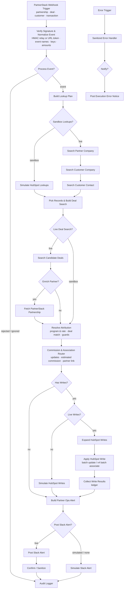

# n8n-hubspot-partnerstack-deal-attribution-sync

**PartnerStack referral, affiliate and reseller events → the right HubSpot deal, company and contact → partner attribution fields, a deal-to-partner link and estimated commission, kept in step as deals are registered, won and paid.**

I built this n8n workflow for teams that run a partner program in PartnerStack but report pipeline in HubSpot. Without it, partner-sourced revenue ends up as a spreadsheet join that someone redoes every quarter. This workflow listens to PartnerStack's partnership, deal, customer and transaction events. It finds the matching HubSpot records, writes the partner key, program, tier and reward type onto them, links the deal to the partner's company, and keeps an estimated commission and partner-sourced revenue figure on the deal. It refuses to guess when a match is ambiguous, keeps the first partner when two claim the same account (configurable), and flags suspected self-referrals.

> **Safe by default.** `SANDBOX_MODE=true` and `DRY_RUN=true`. Out of the box, the workflow runs only against pinned fictional PartnerStack events. It makes no HubSpot, PartnerStack or Slack calls until you turn both switches off.

Built by DH Robin · dhRobin Systems · MIT licensed.

---

## Table of Contents

1. [Why this exists](#1-why-this-exists)
2. [Architecture](#2-architecture)
3. [Repository layout](#3-repository-layout)
4. [Quick start](#4-quick-start)
5. [PartnerStack webhook payloads & authentication](#5-partnerstack-webhook-payloads--authentication)
6. [Partner programs, tiers & reward types](#6-partner-programs-tiers--reward-types)
7. [HubSpot custom property mapping](#7-hubspot-custom-property-mapping)
8. [Deal & company matching logic](#8-deal--company-matching-logic)
9. [Commission tracking rules](#9-commission-tracking-rules)
10. [Partner ops alerts](#10-partner-ops-alerts)
11. [Environment variables](#11-environment-variables)
12. [Node configuration](#12-node-configuration)
13. [Testing stages](#13-testing-stages)
14. [Security & privacy model](#14-security--privacy-model)
15. [Troubleshooting](#15-troubleshooting)
16. [Known limitations](#16-known-limitations)
17. [Disclaimer & license](#17-disclaimer--license)

---

## 1. Why this exists

Partner attribution usually breaks in the same places:

- **Registrations never reach the CRM deal.** A partner registers "Harbor Logistics" in PartnerStack, while the AE already has a HubSpot deal for it. Nobody connects the two, so the deal reports as direct.
- **Wins don't flow back.** The deal closes in HubSpot, finance asks which partner sourced it, and the answer depends on who remembers.
- **Two partners claim one account,** and the last spreadsheet edit wins.
- **Recurring affiliate revenue is invisible** on the deal that produced it.

I designed this workflow so that every PartnerStack event either lands on a specific HubSpot record with a recorded reason, or raises an alert explaining why it didn't.

## 2. Architecture



| Required component | Nodes |
|---|---|
| 1 · PartnerStack Webhook Trigger | `PartnerStack Webhook Trigger` (raw body on, 12 pinned fictional events) |
| 2 · Signature Verification & Event Normalizer | `Verify Signature & Normalize Event` |
| 3 · HubSpot Company & Deal Attribution Engine | `Build Lookup Plan`, the three searches, `Pick Records & Build Deal Search`, `Search Candidate Deals`, `Fetch PartnerStack Partnership`, `Resolve Attribution` (sandbox: `Simulate HubSpot Lookups`) |
| 4 · Commission & Deal Association Router | `Commission & Association Router`, `Expand HubSpot Writes`, `Apply HubSpot Write`, `Collect Write Results` (dry run: `Simulate HubSpot Writes`) |
| 5 · Audit Logger & Sanitized Error Handler | `Audit Logger`, `Sanitized Error Handler`, `Sanitize Slack Error` |

The sandbox and live paths come back together at the same nodes, and each simulator returns the shape of the real API response. A sandbox run therefore exercises the same matching, commission and logging code as production.

## 3. Repository layout

```
n8n-hubspot-partnerstack-deal-attribution-sync/
├── README.md        ← this file
├── workflow.json    ← import into n8n (inactive, sandbox defaults, pinned fixtures)
├── DISCLAIMER.md
└── LICENSE          ← MIT
```

All logic lives in Code nodes inside `workflow.json`. There are no community nodes and no stored n8n credentials. Every secret comes from an environment variable.

## 4. Quick start

1. In n8n, go to **Workflows → Import from File** and select `workflow.json`. The workflow imports **inactive**.
2. Open it and click **Execute Workflow**. The trigger replays 12 pinned fictional events.
3. Open **Audit Logger** and compare the records with the table in [Stage 1](#stage-1--sandbox-pinned-fixtures-no-network).
4. Open **Simulate HubSpot Writes (Dry Run)** to see every property update and link that would have been sent, and **Build Partner Ops Alert** for the Slack messages.

### n8n platform prerequisites

| Setting | Why |
|---|---|
| `N8N_BLOCK_ENV_ACCESS_IN_NODE=false` | Code nodes and expressions read configuration through `$env`. If access is blocked, the helpers fall back to the safe defaults. |
| `NODE_FUNCTION_ALLOW_BUILTIN=crypto` | Needed for HMAC and constant-time comparison. Without it, every event is rejected (`crypto_module_unavailable`). |
| Concurrency of 1 for this workflow | The idempotency ledger in static data isn't transactional, and transaction increments read-then-write. |
| Settings → Error Workflow = this workflow | Activates the sanitized error branch. |

## 5. PartnerStack webhook payloads & authentication

### 5.1 What PartnerStack sends (read this first)

I checked PartnerStack's webhook documentation before writing the verifier:

- **No signing.** Webhooks are created with `POST https://api.partnerstack.com/api/v2/webhooks` and only two fields, `events` and `target_url`. The docs don't describe a signing secret or a signature header.
- **Flat JSON.** Deliveries are flat objects. Most carry an `event` field, but the published deal sample doesn't.
- **Two spellings.** The event list uses dot notation (`deal.created`), while some samples use underscores (`partnership_created`).
- **Event families:** partnerships, deals, customers, transactions, leads and several others.

So the workflow offers two authentication modes, and the normalizer accepts either spelling.

### 5.2 Authentication (fails closed)

| Mode (`PARTNERSTACK_AUTH_MODES`) | Checks | Use when |
|---|---|---|
| `url_token` | The `?key=` query parameter (`PARTNERSTACK_URL_TOKEN_PARAM`) equals `PARTNERSTACK_WEBHOOK_SECRET`, compared in constant time | PartnerStack posts directly. The secret lives in the `target_url` you register. |
| `hmac_sha256` | `X-Attribution-Signature: sha256=<hex>` equals HMAC-SHA256(secret, `"<X-Attribution-Timestamp>.<raw body>"`), with the timestamp within `SIGNATURE_TOLERANCE_SECONDS` (300) | A relay or gateway (Hookdeck, an iPaaS, your own function) receives PartnerStack's delivery and re-signs it |

When a signature header is present, HMAC is mandatory for that delivery. A URL token can't be used to bypass a bad signature. To accept only signed relay traffic, set `PARTNERSTACK_AUTH_MODES=hmac_sha256`.

Register the webhook, one per event family if you like:

```bash
curl -u "$PARTNERSTACK_PUBLIC_KEY:$PARTNERSTACK_API_KEY" -H "Content-Type: application/json" \
  -X POST https://api.partnerstack.com/api/v2/webhooks \
  -d '{"events":["deal.created","deal.updated"],"target_url":"https://YOUR_N8N_HOST/webhook/partnerstack-attribution?key=YOUR_PARTNERSTACK_WEBHOOK_SECRET&event=deal.updated"}'
```

The optional `&event=` parameter names the event for payloads that don't carry one (the deal sample). Without it, the normalizer infers the object type from the fields present and treats the event as `<type>.updated`.

A URL token proves the sender knows the URL. It doesn't protect the body or stop replays, and the idempotency ledger (5.4) is what makes replays harmless. URLs can also appear in proxy and n8n execution logs, so rotate the secret if those are exposed, or use a signing relay.

### 5.3 Payloads used

**Partnership** (partner registration), `partnership.created` / `partnership.updated`:

```json
{ "id": 7101, "partner_key": "cedar-fixture", "first_name": "Avery", "last_name": "Fixture", "email": "avery@cedar-fixture.example",
  "group": { "id": 12, "name": "Silver Referral Partners", "slug": "silver-referral-partners" }, "event": "partnership_created", "archived": false }
```

**Deal** (deal registration and stage changes), `deal.created` / `deal.updated` (and `deal.stage_updated` where sent):

```json
{ "account_name": "Harbor Fixture Logistics", "amount": 36000, "close_date": 1797292800000, "company_id": 6,
  "contact_first_name": "Riley", "contact_last_name": "Fixture", "created_at": 1794816000000, "key": "deal_fx1001",
  "meta": { "company_domain_x7k2p9": "harbor-fixture.example", "contact_email_q4m1z8": "riley@harbor-fixture.example" },
  "partner_key": "bluebird-fixture", "stage": "Registered", "updated_at": 1794816000000 }
```

PartnerStack appends a random suffix to custom-field keys in `meta`, so the normalizer matches by **prefix**. `DEAL_DOMAIN_META_KEYS` (default `company_domain,domain,website,company_website`) supplies the customer domain, and `DEAL_EMAIL_META_KEYS` (default `contact_email,email,customer_email`) supplies a contact e-mail. Add a "Company domain" field to your deal registration form. It's the single most useful matching key. Contact names are never copied.

**Customer** (referral or affiliate signup), `customer.created` / `customer.updated`:

```json
{ "id": 8802, "key": "cus_fx_orchid", "email": "sam@orchid-fixture.example", "name": "Sam Fixture", "partner_key": "pinecone-fixture",
  "created_at": 1794808800000, "updated_at": 1794808800000, "archived": false, "event": "customer.created" }
```

**Transaction** (payment that drives commission), `transaction.created`:

```json
{ "id": 9901, "customer_key": "cus_fx_lumen", "partner_key": "pinecone-fixture", "currency": "USD", "amount": 120000,
  "key": "txn_fx_0100", "event": "transaction.created", "archived": false, "created_at": 1794805200000, "updated_at": 1794805200000 }
```

Transaction amounts are treated as **cents** (`TRANSACTION_AMOUNT_IN_CENTS=true`), and deal amounts as whole currency units. Check this against a real delivery from your account and flip the flag if needed.

### 5.4 Filters & idempotency

| Check | Default | Ignored as |
|---|---|---|
| Event name known (or inferable) | — | `event_type_unknown` |
| In `PROCESS_EVENT_TYPES` | deal.created/updated/stage_updated, customer.created/updated, transaction.created, partnership.created/updated | `event_type_not_processed` |
| Not archived (except partnerships) | — | `archived_record` |
| Has a record key | — | `missing_object_key` |
| Has a partner key (except transactions) | — | `no_partner_key` |
| `event:key:updated_at` not seen in this batch or the ledger | 45 days (`EVENT_LEDGER_DAYS`) | `duplicate_event` |

An event enters the ledger only after **every** HubSpot write for it succeeded. Two more guards live on the HubSpot side, so they still work if the ledger is lost:

- **Stale deal events:** `ps_last_event_at` on the deal blocks out-of-order or older deal updates.
- **Repeat transactions:** `ps_last_transaction_key` on the deal or company blocks a transaction from being applied twice.

## 6. Partner programs, tiers & reward types

### 6.1 Where the program comes from

The program is taken from the first of these that's available:

1. The partnership event's `group`.
2. The PartnerStack Vendor API (`GET /api/v2/partnerships/{partner_key}`, Basic auth with public key and secret key). This is optional (`PARTNERSTACK_ENRICH_PARTNER`) and runs only when both keys are set.
3. The HubSpot partner company (`ps_program_type`, `ps_partner_tier`), written by earlier partnership events.
4. `DEFAULT_PROGRAM_TYPE` (`referral`).

Map your PartnerStack groups explicitly with `PARTNER_GROUP_MAP_JSON`:

```json
{ "gold-resellers": { "programType": "reseller", "tier": "gold" },
  "silver-referral-partners": { "programType": "referral", "tier": "silver" },
  "creator-affiliates": { "programType": "affiliate", "tier": "bronze", "commissionRate": 0.25 } }
```

Unmapped groups are inferred from the slug or name: "resell", "VAR" or "distributor" means reseller; "affiliate", "influencer" or "creator" means affiliate; anything else is referral. The tier comes from platinum, gold, silver, bronze or tier-N.

### 6.2 Default rules (`PROGRAM_RULES_JSON`)

| Program | Reward type | Platinum | Gold | Silver | Bronze | Default |
|---|---|---|---|---|---|---|
| reseller | `margin_on_deal` | 30 % | 25 % | 20 % | 15 % | 15 % |
| referral | `percent_of_first_deal` | 25 % | 20 % | 15 % | 10 % | 10 % |
| affiliate | `recurring_percent` | 35 % | 30 % | 25 % | 20 % | 20 % |

The rate is chosen in this order: `ps_commission_rate` on the HubSpot partner company (accepts `0.25` or `25`), then the group map's `commissionRate`, then the table above. These are **illustrative defaults**. Replace them with your program terms.

## 7. HubSpot custom property mapping

Create these properties in a property group named "PartnerStack attribution". The `ps_` prefix is configurable with `PS_PROPERTY_PREFIX`.

### 7.1 Deal properties

| Internal name | Type | Written on |
|---|---|---|
| `ps_partner_key` | single-line text | deal events (unless a first-touch conflict) |
| `ps_partner_name` | single-line text | deal events (partner company name) |
| `ps_program_type` | dropdown: `referral`, `affiliate`, `reseller` | deal events |
| `ps_partner_tier` | single-line text or dropdown | deal events |
| `ps_previous_partner_key` | single-line text | last-touch overwrites only |
| `ps_deal_key` | single-line text, **unique values** recommended | deal events (the PartnerStack deal key) |
| `ps_registration_stage` | single-line text | deal events (PartnerStack stage) |
| `ps_attribution_status` | dropdown: `registered`, `won`, `lost`, `review_self_referral` | deal events |
| `ps_registered_at` / `ps_won_at` | date picker | first registration / first win |
| `ps_reward_type` | dropdown: `margin_on_deal`, `percent_of_first_deal`, `recurring_percent` | deal events |
| `ps_commission_rate` | number | deal events |
| `ps_commission_status` | dropdown: `pending`, `eligible`, `accruing`, `not_eligible`, `review` | deal + transaction events |
| `ps_estimated_commission` | number (currency) | won / lost / affiliate transactions |
| `ps_partner_sourced_revenue` | number (currency) | transaction events |
| `ps_last_transaction_key` | single-line text | transaction events |
| `ps_last_event_at` / `ps_last_sync_at` | date picker | every write |

### 7.2 Company properties

| Internal name | Customer company | Partner company |
|---|---|---|
| `ps_partner_key` | referring partner | the partner's own key |
| `ps_partner_name`, `ps_program_type`, `ps_partner_tier` | yes | `ps_program_type`, `ps_partner_tier` |
| `ps_attribution_status` | `referred` / `registered` / `customer` | — |
| `ps_referred_at` | first referral only | — |
| `ps_customer_key` | PartnerStack customer key | — |
| `ps_partner_sourced_revenue`, `ps_last_transaction_key`, `ps_last_transaction_at` | transaction events | — |
| `ps_partner_group`, `ps_partner_status` (`active`/`archived`), `ps_commission_rate`, `ps_last_sync_at` | — | partnership events |

### 7.3 Contact properties

`ps_partner_key` and `ps_customer_key` (customer events).

### 7.4 Deal ↔ partner link

The deal is associated with the **partner's company** using a **custom association label**, so the partner never shows up as an ordinary associated company. Create a deal → company label (for example "Referring partner") under Settings → Objects → Deals → Associations. Read its ID with `GET /crm/v4/associations/deals/companies/labels` and set `HUBSPOT_PARTNER_ASSOCIATION_TYPE_ID` (category `USER_DEFINED`). Until it's set, the link is skipped with a note, and the properties are still written.

### 7.5 Private app scopes

`crm.objects.companies.read`, `crm.objects.companies.write`, `crm.objects.deals.read`, `crm.objects.deals.write`, `crm.objects.contacts.read`, `crm.objects.contacts.write`, and `crm.schemas.deals.read` (to look up association labels).

## 8. Deal & company matching logic

### 8.1 Records searched (every event, `POST /crm/v3/objects/{type}/search`)

| Record | Filter |
|---|---|
| Partner company | `ps_partner_key EQ partner_key`; on partnership events also `domain EQ` the partner's e-mail domain (and `www.`) |
| Customer company | deal / customer events: `domain EQ` the customer domain (and `www.`); transactions: `ps_customer_key EQ customer_key` |
| Customer contact | `email EQ` (customer events, deal meta e-mail); transactions: `ps_customer_key EQ` |
| Candidate deals | `ps_deal_key EQ deal key` **OR** `associations.company EQ` the customer company, sorted by `hs_lastmodifieddate` |

Searches that don't apply are sent with a filter that returns nothing, so the chain stays linear. Free mailbox domains (gmail.com, outlook.com and similar) are never used for company matching. If no company matches by domain, the contact's primary company is used.

### 8.2 Which deal

| Event | Rule | `dealMatch` |
|---|---|---|
| deal.* | A deal whose `ps_deal_key` equals the PartnerStack deal key | `deal_key` |
| deal.* | Otherwise the customer company's **single** open deal with no deal key | `company_open_deal` |
| deal.* | Several open deals: score by name tokens and amount within 10 %; a unique best wins | `company_open_deal_scored` |
| deal.* | A tie | `ambiguous`: **nothing written**, alert with candidates |
| deal.* | Company found, no open deal | `no_open_deal`: company attribution only, alert |
| deal.* | No company, no deal key | `unmatched`: nothing written, alert |
| transaction.created | The company's won deal for this partner, else its most recent won deal | `company_won_deal` |

After the first match, `ps_deal_key` makes every later event for that deal an exact match.

### 8.3 Guards

- **First touch** (`ATTRIBUTION_MODEL=first_touch`, the default): if a deal, company or contact already carries a different `ps_partner_key`, that record keeps its partner and an `attribution_conflict` alert names both partners. With `last_touch`, the new partner wins and the old key is kept in `ps_previous_partner_key`.
- **Self-referral:** if the customer domain equals the partner company's domain, or the customer company *is* the partner company, no attribution is written. The deal is marked `review_self_referral` if it was matched, and an alert goes out.
- **Lookup errors:** any failed search cancels all writes for that event and raises `lookup_failed`.
- **Duplicates:** several companies on the same domain are flagged.

## 9. Commission tracking rules

Commission figures are **estimates for reporting**. PartnerStack remains the system of record for rewards and payouts.

| PartnerStack event | `ps_commission_status` | `ps_estimated_commission` |
|---|---|---|
| deal registered / working | `pending` | unchanged |
| deal stage in `PS_WON_STAGES` (`Closed Won,Won,closed_won`), reseller or referral | `eligible` | deal amount × rate (PartnerStack amount, else HubSpot amount) |
| deal won, affiliate | `accruing` | unchanged (affiliates earn on transactions) |
| deal stage in `PS_LOST_STAGES` | `not_eligible` | 0 |
| transaction, affiliate (`recurring_percent`) | `accruing` | previous + transaction × rate |
| transaction, reseller or referral | unchanged | unchanged (revenue only) |
| self-referral suspected | `review` | 0 |

Every transaction adds to `ps_partner_sourced_revenue` on the company and on the won deal. A transaction in a currency other than `COMMISSION_CURRENCY` (USD) isn't added, and raises a `currency_mismatch` alert.

Worked examples from the fixtures:
- **Quarry Fixture Foods:** a silver referral deal of 52,000 is won, so 52,000 × 15 % = **7,800**, eligible.
- **Lumen Fixture Studio:** a bronze affiliate has a $1,200 transaction (120000 cents) at 25 %, so +300 accrued (150 → 450) and revenue goes from 600 to 1,800.

## 10. Partner ops alerts

`Build Partner Ops Alert` posts Block Kit to `SLACK_WEBHOOK_URL` for:

- 🏆 partner-sourced wins (`NOTIFY_ON_PARTNER_WIN=true`)
- 🔎 unmatched registrations
- 🔀 ambiguous deals (with candidates)
- 📝 registrations without an open deal
- ⚖️ attribution conflicts (both partner keys)
- 🚩 suspected self-referrals
- 🏢 new partners with no HubSpot company
- 💱 currency mismatches
- ⚠️ lookup or write failures (the HubSpot error message)

Each alert shows the event, partner, program and tier, customer, matched deal, amount and estimated commission, with buttons for the deal, the customer company and the partner. Alerts carry account names and keys only, never contact names, e-mails or phone numbers.

## 11. Environment variables

Copy this block into your n8n environment and replace every placeholder.

```bash
# ── Safety switches (both must be "false" before anything is written) ──
SANDBOX_MODE=true
DRY_RUN=true

# ── PartnerStack ──
PARTNERSTACK_WEBHOOK_SECRET=YOUR_PARTNERSTACK_WEBHOOK_SECRET
# url_token (direct) and/or hmac_sha256 (signing relay)
PARTNERSTACK_AUTH_MODES=hmac_sha256,url_token
PARTNERSTACK_URL_TOKEN_PARAM=key
ATTRIBUTION_SIGNATURE_HEADER=x-attribution-signature
ATTRIBUTION_TIMESTAMP_HEADER=x-attribution-timestamp
SIGNATURE_TOLERANCE_SECONDS=300
PROCESS_EVENT_TYPES=deal.created,deal.updated,deal.stage_updated,customer.created,customer.updated,transaction.created,partnership.created,partnership.updated
EVENT_LEDGER_DAYS=45
TRANSACTION_AMOUNT_IN_CENTS=true
DEAL_DOMAIN_META_KEYS=company_domain,domain,website,company_website
DEAL_EMAIL_META_KEYS=contact_email,email,customer_email
PS_WON_STAGES=Closed Won,Won,closed_won
PS_LOST_STAGES=Closed Lost,Lost,closed_lost,Disqualified
# Optional partner enrichment (Vendor API, Basic auth)
PARTNERSTACK_ENRICH_PARTNER=true
PARTNERSTACK_PUBLIC_KEY=YOUR_PARTNERSTACK_PUBLIC_KEY
PARTNERSTACK_API_KEY=YOUR_PARTNERSTACK_API_KEY
PARTNERSTACK_API_BASE_URL=https://api.partnerstack.com/api/v2

# ── Programs & commission (one line of JSON each; empty = defaults) ──
PARTNER_GROUP_MAP_JSON=
PROGRAM_RULES_JSON=
DEFAULT_PROGRAM_TYPE=referral
ATTRIBUTION_MODEL=first_touch
COMMISSION_CURRENCY=USD

# ── HubSpot ──
HUBSPOT_ACCESS_TOKEN=YOUR_HUBSPOT_PRIVATE_APP_TOKEN
HUBSPOT_PORTAL_ID=YOUR_HUBSPOT_PORTAL_ID
HUBSPOT_API_BASE_URL=https://api.hubapi.com
HUBSPOT_APP_BASE_URL=https://app.hubspot.com
PS_PROPERTY_PREFIX=ps_
HUBSPOT_PARTNER_ASSOCIATION_TYPE_ID=YOUR_PARTNER_ASSOCIATION_LABEL_ID
HUBSPOT_PARTNER_ASSOCIATION_CATEGORY=USER_DEFINED

# ── Slack (optional) ──
SLACK_WEBHOOK_URL=YOUR_SLACK_WEBHOOK_URL
NOTIFY_ON_PARTNER_WIN=true
SLACK_NOTIFY_ON_MONITOR_ERROR=true

# ── Audit ──
AUDIT_LOG_TO_STDOUT=true
AUDIT_RING_BUFFER_SIZE=500

# ── n8n platform ──
N8N_BLOCK_ENV_ACCESS_IN_NODE=false
NODE_FUNCTION_ALLOW_BUILTIN=crypto
```

Flags accept only `true/1/yes/on` or `false/0/no/off`. Anything else keeps the safe default. Values starting with `YOUR_` are treated as unset where it matters (the association label, PartnerStack keys). Keep comments on their own lines, because Docker env files don't support inline comments.

## 12. Node configuration

| Node | Type | Key settings |
|---|---|---|
| PartnerStack Webhook Trigger | Webhook v2 | POST `partnerstack-attribution` · Respond immediately · **Raw Body on** |
| Verify Signature & Normalize Event | Code v2, all items | auth, event names, normalisation, ledger dedupe |
| Process Event? / Sandbox Lookups? / Live Deal Search? / Enrich Partner? / Has Writes? / Live Writes? / Post Slack Alert? | IF v2.2 | strict, case-sensitive |
| Search Partner Company / Customer Company / Customer Contact / Candidate Deals | HTTP Request v4.2 | `Authorization: Bearer {{$env.HUBSPOT_ACCESS_TOKEN}}` · full response · never error · 3 tries |
| Fetch PartnerStack Partnership | HTTP Request v4.2 | `Authorization: Basic` from `PARTNERSTACK_PUBLIC_KEY:PARTNERSTACK_API_KEY` (built with n8n's `.base64Encode()`; or swap in a Basic Auth credential) |
| Resolve Attribution / Commission & Association Router | Code v2, each item | sections 6, 8, 9 |
| Expand HubSpot Writes → Apply HubSpot Write → Collect Write Results | Code (all) → HTTP POST → Code (all) | `batch/update` and v4 `batch/create`, both idempotent · 3 tries |
| Build Partner Ops Alert → Post Slack Alert | Code v2 + HTTP Request v4.2 | `continueErrorOutput` → Sanitize Slack Error |
| Audit Logger | Code v2, each item | redacted record · stdout · `psAttributionAudit` ring buffer (not in sandbox) |
| Error Trigger → Sanitized Error Handler | Error Trigger v1 + Code v2 | redacted summary, optional Slack notice |

## 13. Testing stages

### Stage 1 · Sandbox (pinned fixtures, no network)

`SANDBOX_MODE=true`, `DRY_RUN=true`. Execute the workflow and compare the 12 Audit Logger records:

| Event | Auth | Expected |
|---|---|---|
| `partnership_created` · cedar-fixture | URL token | partner company found by e-mail domain → partner key, referral / silver, active |
| `deal.created` · deal_fx1001 (no `event` field, `?event=`) | URL token | gold reseller (PartnerStack API group) · single open deal → registered, pending · company · partner link |
| `deal.updated` · deal_fx1002 Closed Won | HMAC | deal-key match · eligible, 7,800 · 🏆 alert |
| `deal.updated` · deal_fx1002 (older) | HMAC | `stale_event` · nothing written |
| `customer.updated` · cus_fx_lumen | URL token | same partner already attributed → contact + company refreshed |
| `customer.created` · cus_fx_orchid | URL token | ⚖️ conflict · first touch keeps maple-fixture |
| `transaction.created` · txn_fx_0100 | URL token | +300 accrued (450) · revenue 1,800 |
| `transaction.created` · txn_fx_0099 | URL token | `transaction_already_applied` |
| `deal.created` · deal_fx1005 | HMAC | 🔀 ambiguous (two open deals) · nothing written |
| `deal.created` · deal_fx1006 | HMAC | 🚩 self-referral · nothing written |
| `deal.created` · deal_fx1007 | wrong key | rejected · `url_token_mismatch` |
| `lead_created` | URL token | ignored · `event_type_not_processed` |

All partner and customer names, domains (`*.example`), keys, IDs, amounts and secrets in the fixtures are fictional.

### Stage 2 · Shadow (real lookups, writes simulated)

`SANDBOX_MODE=false`, `DRY_RUN=true`, against a **HubSpot test account or sandbox** and PartnerStack **test** keys:

1. Create the properties in section 7 and the association label, and set `HUBSPOT_PARTNER_ASSOCIATION_TYPE_ID`.
2. Create a partner company with `ps_partner_key`, a customer company with your test domain, and an open deal.
3. Register a test webhook (section 5.2) and submit a deal registration through a test partner.
4. Check `Pick Records & Build Deal Search`, `Resolve Attribution` and `Simulate HubSpot Writes (Dry Run)`. Nothing is written, and Slack is simulated.

### Stage 3 · Live in the test portal

`DRY_RUN=false`. Confirm the deal fields, company fields and the partner link. Move the PartnerStack deal to Closed Won and check `eligible` and the estimate. Re-send an event (duplicate → ignored). Post an older deal update (stale → ignored). Make the workflow its own **Error Workflow** and force a failure (an invalid token) to see the sanitized notice.

### Stage 4 · Production

Start with deal events only, review a week of attribution with your partner manager, then enable customer and transaction events.

## 14. Security & privacy model

- **No secrets in the workflow.** HubSpot, PartnerStack and Slack credentials come from `$env`. The JSON contains only placeholders and a clearly fictional sandbox secret, which is used only while `SANDBOX_MODE=true`.
- **Fails closed.** A missing secret, header, token or `crypto` module rejects the event before any lookup. A present-but-wrong signature can't fall back to the URL token.
- **No record creation.** The workflow updates and links existing HubSpot records only. Unmatched events raise alerts.
- **Minimal personal data.** Contact names from deal registrations are never copied. E-mails are used only to search, never written or logged. The audit log holds keys, IDs, statuses and amounts.
- **Redacted logs.** Keys matching `authorization|token|secret|password|api key|cookie|signature|webhook url` are replaced. Known secret values, Bearer tokens, HubSpot `pat-` tokens, Slack webhook URLs and `?key=` query values are scrubbed from every string, including error messages.
- **Sanitized errors.** The error branch drops stack traces, request options and bodies.
- **Restrict n8n execution data.** Executions contain the full delivery, including the webhook query string. Limit who can open them, and set a retention period.

## 15. Troubleshooting

| Symptom | Likely cause | Fix |
|---|---|---|
| Every event `url_token_missing` | `?key=` not in the registered `target_url` | Update the webhook's `target_url` |
| `signature_mismatch` from a relay | The relay signs a re-serialised body or a different secret | Sign the exact bytes sent; keep **Raw Body** on |
| `event_type_unknown` | Payload without `event`, fields not recognisable | Add `&event=<name>` to the `target_url` |
| Deal events always `unmatched` | No customer domain in the registration | Add a company-domain field to the PartnerStack deal form, or extend `DEAL_DOMAIN_META_KEYS` |
| `ambiguous` | Several open deals on the company | Put the PartnerStack deal key in `ps_deal_key` on the right deal once; later events match exactly |
| Partner link skipped | `HUBSPOT_PARTNER_ASSOCIATION_TYPE_ID` unset | Create the label and set its ID |
| Write 400 "Property does not exist" | Properties not created, or a different prefix | Create them (section 7) or set `PS_PROPERTY_PREFIX` |
| Wrong program or tier | Group not mapped | Set `PARTNER_GROUP_MAP_JSON` |
| Commission 100× too high or low | Amount units | Flip `TRANSACTION_AMOUNT_IN_CENTS` |
| Enrichment never runs | Keys unset, or still placeholders | Set both PartnerStack keys (Vendor API, Basic auth) |

## 16. Known limitations

- **No PartnerStack signature.** Direct deliveries rely on a URL token. Use a signing relay if you need body integrity.
- **Reward events aren't consumed.** PartnerStack's vendor webhook list has no reward events, so commission is estimated from deal amounts, transactions and your rules.
- **Partial transaction failures:** if one of a transaction's writes fails, the key guard prevents a retry from double-counting, so fix the failed record by hand (the alert names it).
- **Partnership lookup path:** I use `GET /api/v2/partnerships/{partner_key}`. Confirm it against your PartnerStack API reference. If it fails, the HubSpot partner company and the defaults still apply.
- **Static data isn't transactional.** Keep concurrency at 1.

---

## 17. Disclaimer & license

### ⚠️ Disclaimer & Liability Limitation

Use at your own risk. The code, workflows, and scripts in this repository (`n8n-hubspot-partnerstack-deal-attribution-sync`) are provided for educational and architectural demonstration purposes.

* **No Liability:** The author and dhRobin Systems accept no responsibility or liability for any direct, indirect, incidental, or consequential damages that result from using, misusing, or deploying these scripts. That includes misattributed or missed partner credit, incorrect commission estimates or payouts, partner disputes, and any record created or changed in a connected system.
* **No Warranty:** All software, n8n JSON blueprints and JavaScript modules are provided "AS IS", without warranty of any kind, express or implied. This includes, but is not limited to, warranties of merchantability, fitness for a particular purpose, and non-infringement.
* **Production Testing Required:** Always test thoroughly in an isolated staging environment, such as a HubSpot developer test account or sandbox, PartnerStack test keys and a test Slack channel, with `SANDBOX_MODE=true` and `DRY_RUN=true` enabled, before you connect live HubSpot, PartnerStack or Slack credentials. Treat every commission figure as an estimate that a person must reconcile against PartnerStack before anyone is paid.
* **Third-Party APIs & Compliance:** You alone are responsible for complying with the terms of service, rate limits, data privacy regulations (GDPR/CCPA), partner agreements, and security policies of PartnerStack, HubSpot, Slack and any connected services. That includes telling partners and customers how their data is shared between systems, keeping personal data out of logs and alerts, honouring your partner program terms, and reviewing every automatically created or updated record.

The full disclaimer is also available in [DISCLAIMER.md](https://github.com/dhrobinsystems/n8n-hubspot-partnerstack-deal-attribution-sync/blob/main/DISCLAIMER.md).

### License

Released under the MIT License. Copyright (c) 2026 DH Robin (dhRobin Systems). See [LICENSE](https://github.com/dhrobinsystems/n8n-hubspot-partnerstack-deal-attribution-sync/blob/main/LICENSE).

---

Full text: DISCLAIMER.md · Licensed under the MIT License. License: MIT © 2026 DH Robin (dhRobin Systems) · Provided as-is, see the disclaimer.
